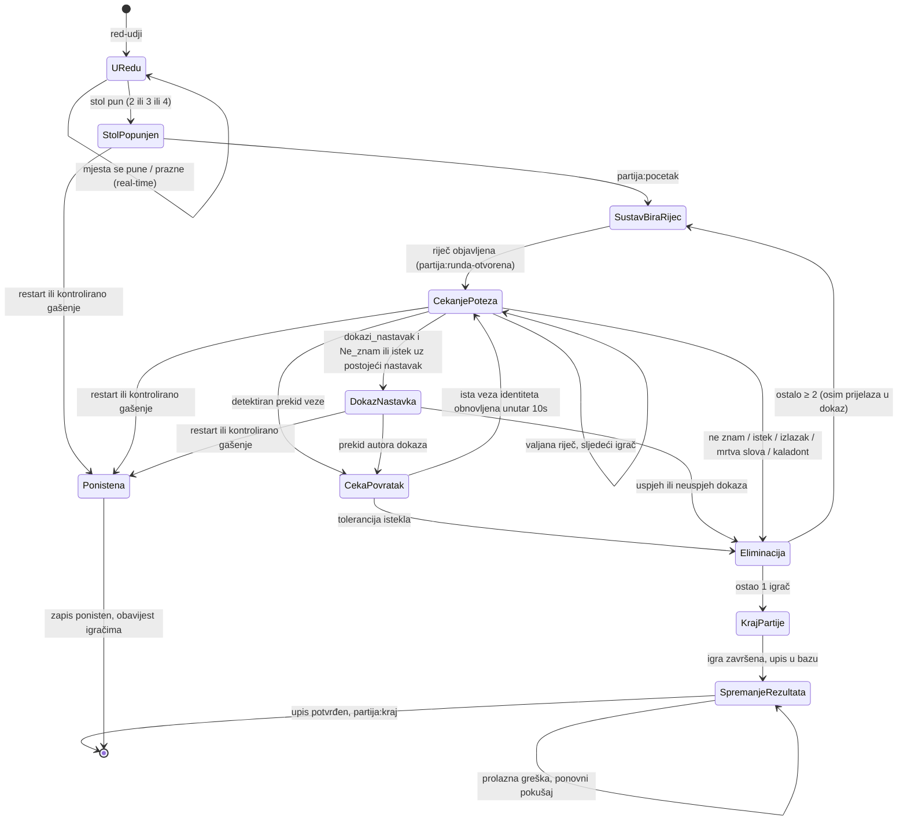
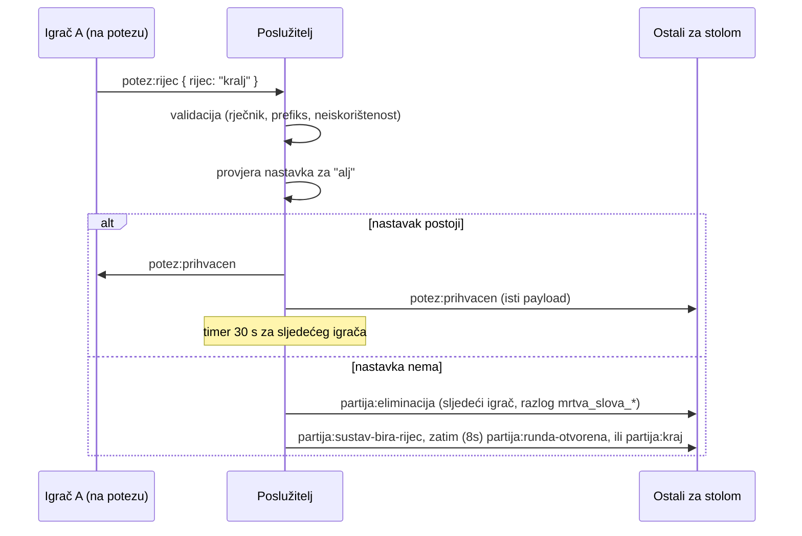

# Životni ciklus partije

## Dijagram stanja

Napomene:

<!-- HINT PR15: faza DokazNastavka = dokaz:zatrazen; bez nove sistemske riječi između odustajanja i dokaza. -->

- **SustavBiraRijec:** nakon eliminacije ili Kaladont-efekta traje 5 sekundi; nitko ne može igrati. Kandidati nikad ne završavaju na „ka” (PR02). Prva dodjela ne dodaje ovu pauzu postojećem početnom odbrojavanju. Timer poteza kreće tek po dodjeli riječi; trening ostaje bez timera.
- **DokazNastavka (PR05):** u `dokazi_nastavak` nakon Brunina „Ne znam”/isteka/napuštanja (dok nastavak postoji) emitira se `dokaz:zatrazen`; Ana igra na isti prefiks. Snapshot/reconnect vraća istu fazu i `turnToken`. Između Brunina odustajanja i Anina dokaza **nema** nove sistemske riječi.
- **Prikaz rezultata:** `prikazRezultataOdIso` određuje pauzu do detalja — 8 s uobičajeno (`ODGODA_PRIKAZA_REZULTATA_MS`), 3 s u Treningu; spremanje ne čeka taj rok.
- **Mrtva slova:** u Klasičnom/KA-zna eliminiraju sljedećeg (RS-02/03); u Dokaži nastavak autora riječi (RS-31).
- **CekaPovratak:** 10-sekundna tolerancija; istek poteza ima prednost; dobrovoljni izlazak ne ulazi ovdje.
- Eliminirani igrač prelazi u ulogu **promatrača** do `KrajPartije`.

## Slijed poruka za tipičan potez

## Timeri

- Jedini mjerodavni timer je na poslužitelju; 30s timer poteza pokreće se u trenutku emitiranja `potez:prihvacen` / `partija:runda-otvorena` (ne dok sustav bira riječ).
- Klijent dobiva apsolutni `istekPotezaIso` pa ni kašnjenje mreže ne pomiče prikaz.
- Istek na poslužitelju okida eliminaciju čak i ako klijent šuti ili je privremeno odspojen. Ponovno spajanje ne resetira niti pomiče `istekPotezaIso`.

## Kontekst partije i politika učinaka (ADR-017)

Stol pri stvaranju dobiva `kontekst: javna | privatna | trening | izazov` i iz njega izvedenu `PolitikaUcinkaPartije`. Javna partija piše povijest i puni natjecateljski napredak (XP, rang, DNK, forma, bodovi). Privatna, trening i izazov također zbrajaju XP za odigrane riječi u `iskustvoUkupno` te pišu kolekcije i opća dostignuća riječi (npr. Dugometraš, Rijetkolovac), ali bez ranga/DNK/forme/bodova. Trening nema zapis partije; pobjeda dodatno idempotentno zabilježi Zagrijan. Gosti i privremeno Računalo nemaju DB upise. Tehnički prekid treninga ne daje pobjedu ni poraz.

Trening emitira upozorenje neaktivnosti nakon 4 minute i poništava sesiju nakon 5 minuta. Resetiraju je samo prihvaćen ljudski potez ili scoped `trening:nastavi`; heartbeat, reconnect i botov potez ne resetiraju sat.

Potezi ljudi i botova prolaze iste autoritativne naredbe `odigrajRijec` / `odustani` (turnToken, red na potezu, faza izbora sustava, validacija). Socket handleri su tanki omotači koji identitet uzimaju iz sesije; `naredbaBota` prihvaća samo sudionike s `upravljac = bot`. Pokretanje partije vraća eksplicitan rezultat (`pokrenuta`, `limit`, `zaustavljanje`, `greska`), pa servis reda vraća u red samo ljude koji još čekaju, s izvornim `usaoU`.

Bot kontroler sluša `naPromjenuPoteza` i za bota na potezu planira točno jednu akciju po `(partijaId, igracId, turnToken)`. Pri buđenju ponovno provjerava token, verziju rječnika i legalnost; zakaanjeli callback ne igra u novoj rundi. Namjerni propust ide kroz redovnu naredbu „ne znam”; odbijena riječ je tehnička greška i broji se zasebno. Fond javnih botova drži rezervacije s generacijom; bot se oslobađa tek kad motor više ne drži njegovu partiju (`imaNezavrsenuObradu` = false), ne pri eliminaciji.

## Kraj partije — transakcija

Završetak igre i spremanje rezultata su dva odvojena stanja. Motor prvo zaustavlja poteze i računa konačne plasmane, ali zadržava partiju u memoriji sa statusom `spremanje_rezultata`. Prije završne transakcije motor idempotentno osigurava upis početka partije i svih poteza (`zapisiPotez` ne guta DB grešku). Dok traje prolazni problem s bazom, ponavlja isti završni upis s eksponencijalnim odmakom i igračima šalje `partija:spremanje-rezultata`.

U jednoj transakciji: upis `plasman/bodovi/eliminacije/iskustvo/nacin_ispadanja` u `sudionici_partije` → ažuriranje agregata u `igraci`, uključujući trajni XP → status partije `zavrsena`. Završni upis mora biti idempotentan za isti `partijaId`, jer pokušaj može biti ponovljen nakon prekida veze s bazom. Tek nakon potvrđene transakcije motor sprema personalizirane rezultate, emitira `partija:kraj`, zatvara privatnu sobu i zakazuje brisanje memorijskog stanja.

`partija:kraj` je potvrda da su rezultati trajno spremljeni, a ne samo da je igra završila. Oporavak vrijedi dok proces radi; otpornost na restart procesa zahtijevala bi trajni outbox.

## Restart i kontrolirano gašenje

Pri podizanju poslužitelja svi redovi `partije` sa statusom `u_tijeku` prelaze u `ponistena`. To su partije čije je memorijsko stanje izgubljeno restartom i ne smiju ponovno izgledati kao aktivne.

Pri `SIGTERM`/`SIGINT` poslužitelj prvo prestaje prihvaćati nova uparivanja i pokretanja privatnih partija, zatim aktivnim klijentima šalje `partija:ponistena`, označava njihove zapise kao `ponistena`, zaustavlja timere i tek onda zatvara Socket.IO/HTTP poslužitelj. Igrač dobiva jasnu poruku da rezultat nije dodijeljen i može se vratiti na naslovnicu.

Igrač eliminiran bez dobrovoljnog izlaska može prije toga dobiti privatni `iskustvo:obracun` za konačne poteze i streak; taj prikaz ne obavlja isplatu. Stvarni zapis XP-a ostaje dio završne transakcije, pa se ne može dodijeliti dvaput reconnectom.
