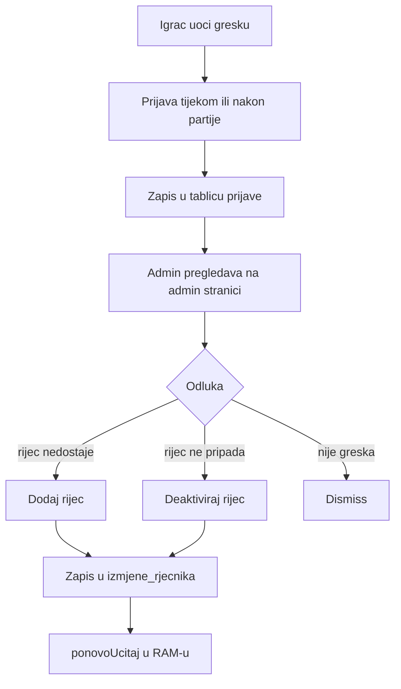

# Održavanje rječnika

Rječnik na startu **nije savršen** i to je svjesna odluka: umjesto nemoguće savršene baze, gradimo **petlju povratnih informacija** s igračima. Kvaliteta rječnika je proizvod zajednice.

## Petlja povratnih informacija

## Prijava riječi (perspektiva igrača)

1. Igrač otvori panel **Prijavi riječ** (dostupan tijekom i nakon partije, ispod zone igre).
2. Mini toggle: **Odigrane** (prihvaćene riječi → admin može obrisati) ili **Moje odbijene** (vlastite `RIJEC_NE_POSTOJI` → admin može dodati).
3. Limit **3 + 3** po partiji (odvojeno po tipu). Nema poruke ni emaila; lokalna zelena potvrda.
4. Nakon klika gumb prelazi u „Prijavljeno”; ponovni klik nije dopušten.

Tipični povodi prijave:

| Situacija                                          | Tip prijave     | Admin akcija |
| -------------------------------------------------- | --------------- | ------------ |
| Prihvaćena riječ koja ne postoji                   | `za_brisanje`   | Obriši       |
| Odbijena riječ koja bi trebala proći               | `za_dodavanje`  | Dodaj        |

## Admin stranica (perspektiva admina)

- Tri reda: riječi za brisanje, riječi za dodavanje, računi s pogrdnim nadimkom.
- Potvrda-popup na svaku akciju (**Obriši** / **Dodaj** / **Dismiss**; **Obriši račun** / **Pusti**) s opcionalnom napomenom (max 300 znakova) koja ide prijavitelju u sandučic.
- **Uvažavanje** i **odbacivanje** šalju sandučic svim prijaviteljima iste riječi / istog računa (fan-out). Dostignuća samo na uvažavanju.
- **Dodaj** u popupu bira rijetkost; default vrsta ostaje `imenica`; ručni obrazac i dalje bira vrstu.
- **Obriši / Deaktiviraj** (#75): pregled svih aktivnih oblika iz **izravnih** leksičkih grupa prijavljenog/testiranog oblika, jedna potvrda, soft-delete cijelog popisa. Homograf širi obuhvat na uniju članova izvornih grupa, bez „susjeda susjeda”.
- Ručni rječnik: tabovi Ručno / Izmjene / Test / Čišćenje; pretraga, grupna deaktivacija/vraćanje jednog oblika, dodavanje s obaveznom vrstom; masovno soft-brisanje aktivnih nstandardnih oblika (q/w/x/y i ostalo izvan hrvatske abecede).
- Nakon izmjene RAM se osvježava inkrementalno (`primijeniUklanjanja` / `primijeniUbaci`) — aktivne partije odmah vide novu validaciju za buduće poteze. Restart nije potreban.
- Bez email obavijesti; prijavitelj dobiva sandučic na uvažavanje ili odbacivanje. Admin se ulogira i pregleda.

### Grupno dodavanje (#89)

- **Dodaj** koristi isti ugovor kao uklanjanje: pregled → otisak → potvrda s `kljucOperacije`.
- Admin unosi lemu, vrstu, izvorni oblik, dodatne oblike i tier po redu („Zadrži” = ne mijenja frekvenciju postojećeg aktivnog oblika).
- Homograf aktivnog oblika u drugoj grupi zahtijeva `potvrdiPreklapanja`.
- Ručne grupe idu u `rucno_dodane_grupe`; ručni tier u `rucna_frekvencija` (hrLex UPSERT ih ne prepisuje).
- Nakon potvrde RAM se inkrementalno osvježava za sve promijenjene oblike; aktivne partije nadopunjavaju `iskoristeneGrupe` za već odigrane oblike.

### Trenutačni administrativni put

Admin stranica i rute koriste stvarnu sesiju registriranog računa s `vrsta = 'admin'`.

Prije produkcije još treba implementirati jednokratni CLI koji već registriranom i potvrđenom računu sigurno dodjeljuje prvu admin ulogu. Dodavanje iznimke digrafa i dalje zahtijeva PR i redeploy.

## Pravila izmjena

1. **Soft-delete:** riječi se nikad ne brišu, samo deaktiviraju (`aktivna = false`) — povijest odigranih partija ostaje razumljiva. Članstva u `grupe` ostaju za buduće vraćanje.
2. **Grupno uklanjanje:** obuhvat = aktivni oblici koji dijele barem jedan izravni ključ polazišnog oblika. Pregled je read-only; potvrda ponovno računa otisak (`409` ako je zastario).
3. **Primjena na aktivne partije:** izmjena rječnika ne mijenja već prihvaćene poteze, ali može utjecati na buduće validacije u aktivnim partijama nakon osvježenja RAM-a.
4. **Ponovno učitavanje:** skupne izmjene bumpaju `verzijaRjecnika` jednom; retry ne proizvodi novi audit.
5. **Iznimke digrafa** dodane kroz prijave zahtijevaju ponovni izračun `prva_dva`/`zadnja_dva` samo za tu riječ.

## Ciljevi kvalitete (pratiti od lansiranja)

- Broj prijava po 100 partija — očekivani pad kroz vrijeme.
- Vrijeme od prijave do rješenja — cilj < 48 h dok je projekt malen.
- Omjer prihvaćenih i odbijenih prijava — kalibrira povjerenje u bazu.
