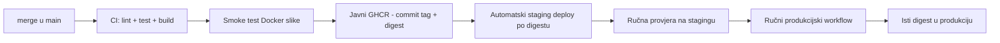
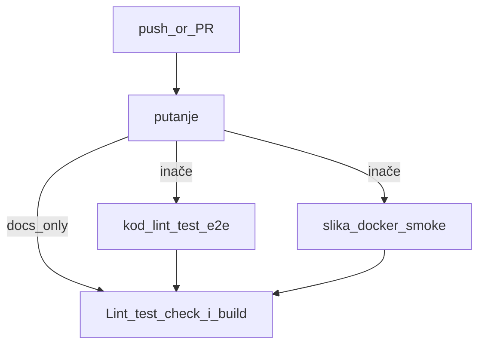

# CI/CD (GitHub Actions)

> **Status 2026-11-03: djelomično implementirano.** `.github/workflows/ci.yml` dijeli poslove (`putanje` → paralelni `kod` / `slika` → agregator **Lint, test, check i build**), uz docs-only path-filter, Playwright cache i least-privilege ovlasti. Main CI pushne candidate, smoke-testira digest, GHCR promovira isti manifest bez rebuilda (ili preskače ako kandidata nema), staging automatski objavljuje digest kad tag postoji, a produkcija se promovira ručnim `workflow_dispatch` uz staging gate i fail-closed backup gate. Prava backup automatika (systemd/`age`/Storage Box) još nije u repou — dok je nema, `skripte/zahtijevaj-svjez-offserver-backup.sh` namjerno pada prije migracija. GitHub Environment `produkcija` i `PROD_*` tajne postavljaju se nakon VPS-a.

Tok objave definiran je [ADR-om 014](../03-arhitektura/odluke/014-operativni-model-mvp-a.md):

Razvojno računalo nema virtualizaciju pa se Docker slika ne može testirati lokalno — **CI je jedino mjesto koje dokazuje da slika radi** prije staginga. Zato smoke test nije opcionalan korak nego bloker objave (osim docs-only pusha).

## Pravila koja vrijede za sve workflowe

- Sve third-party GitHub Actions reference pinaju se na puni commit SHA; komentar uz SHA navodi čitljivu verziju. Dependabot ih ažurira kroz Pull Request (PR).
- Workflow zadano ima `contents: read`. Job `slika` dodatno ima `packages: write` (main candidate) i `security-events: write` (Trivy SARIF). Job `kod` i agregator ostaju na `contents: read`.
- Aplikacijska slika gradi se samo za `linux/amd64`. ARM/multi-arch nije dio početne postave.
- Staging i produkcija imaju zasebne GitHub Environmente i SSH ključeve. Produkcijski Environment nema required reviewer jer postoji jedan operater; ručni `workflow_dispatch` jest kontrolna točka.
- `concurrency` dopušta najviše jedan aktivni deploy po okruženju. Novi staging deploy ne smije se utrkivati sa starim, a produkcijski deploy nikad ne prekida drugi produkcijski deploy.
- SSH veza provjerava unaprijed spremljen host fingerprint. `StrictHostKeyChecking=no` je zabranjen.
- Nema `git pull` ni builda na VPS-u. VPS prima verzionirane konfiguracije i povlači gotovu sliku po digestu.

## Docs-only i chore

Detekcija je **isključivo po putanjama** u difu (base SHA → head SHA). Poruka commita (`docs:`, `chore:`, `[skip ci]`) **ne** utječe na CI.

**Docs-only** vrijedi samo ako je **svaka** izmijenjena datoteka u jednoj od ovih skupina:

| Dopušteno | Primjeri |
| --- | --- |
| `docs/**` | `docs/07-operacije/ci-cd.md` |
| root `*.md` | `README.md` |
| `.cursor/**` | rules, skills |
| `LICENSE` | licenca |

Čim se pojavi bilo što drugo (`.github/**`, `Dockerfile*`, `docker-compose*`, `aplikacije/**`, `paketi/**`, `e2e/**`, `skripte/**`, `package.json`, `pnpm-lock.yaml`, `playwright*`, `Caddyfile*`…), CI je **puni**.

Na docs-only:

1. Jobovi `kod` i `slika` se **preskaču**.
2. Agregator **Lint, test, check i build** ostaje zelen (required check za ruleset).
3. Nema Docker candidatea → `objavi-ghcr` i staging **preskaču promociju/deploy** bez crvenog pada (nema commit SHA taga).

**Chore ≠ skip.** `chore:` koji dira kod, workflow ili lockfile pokreće puni CI. Samo sadržaj diffa odlučuje.

## Preduvjeti implementacije

Prije uključivanja workflowa moraju postojati i biti međusobno usklađeni:

1. produkcijski Dockerfile s jednim Node procesom i OCI oznakom izvornog repozitorija;
2. `docker-compose.staging.yml` i `docker-compose.prod.yml` bez javnog aplikacijskog ili DB porta;
3. staging i produkcijski Caddyfile;
4. jednokratne naredbe u istoj aplikacijskoj slici za migracije, provjeru/uvoz rječnika i dodjelu prvog admina;
5. mali licencno čist sintetički fixture rječnika za CI;
6. prošireni `/zdravlje` koji provjerava bazu i rječnik te vraća 503 kad servis nije spreman;
7. stvarno slanje emaila preko Resenda i E2E provjeru buildanog same-origin web/API servera;
8. verzionirane backup/restore skripte i pripadajuće systemd jedinice.

## CI jobovi — `ci.yml`

Projekt zasad vodi jedan operater. `main` CI je glavni sigurnosni gate prije GHCR promocije i staging deploya. Ako agregator padne, slika se ne promovira.

| Job | Što radi | Ovlasti |
| --- | --- | --- |
| `putanje` | Izračun `docs_only` iz difa | `contents: read` |
| `kod` | install, audit, Trivy secret, migracije, lint, Vitest, web check, build, Playwright cache + E2E (Chromium+WebKit) | `contents: read` |
| `slika` | prod Compose config + sintetički validator konfiguracije, Docker build/candidate, Trivy image+SARIF, Caddy, compose smoke, HTTP E2E, image-smoke, load, simulacija | `contents: read` + `packages: write` + `security-events: write` |
| agregator (**Lint, test, check i build**) | Zelen ako docs-only **ili** (`kod` i `slika` uspješni) | `contents: read` |

`kod` i `slika` idu **paralelno** da lint/Vitest padne ranije, ne tek nakon Docker koraka. Playwright preglednici se predmemoriraju (`~/.cache/ms-playwright`, ključ na `pnpm-lock.yaml`).

Ruleset i dalje traži check **Lint, test, check i build** — to je ime agregatora; ne treba mijenjati branch protection pri splitanju jobova.

## Build i smoke test stvarne slike

Na `main` se slika gradi jednom. Taj lokalni image ili registry digest koristi se u svim sljedećim koracima; nakon testa nema rebuilda za staging ili produkciju.

1. Build multi-stage Dockerfilea za `linux/amd64` samo na uspješnom pushu u `main`.
2. Push kandidata u GHCR pod jedinstvenim tagom `ci-<commit-sha>-<run-id>` i spremanje vraćenog digest-a.
3. Povlačenje kandidata po punom `ghcr.io/...@sha256:<digest>` i podizanje izoliranog Compose stacka s točno pinanom PostgreSQL slikom.
4. Migracije jednokratnom naredbom iz upravo povučenog aplikacijskog digesta.
5. Uvoz **malog sintetičkog testnog rječnika** iz repozitorija; pravi hrLex ne ulazi u git ni CI fixture.
6. Pokretanje aplikacije kao ne-root korisnika u kontejneru.
7. `GET /zdravlje` mora vratiti 200, dostupnu bazu, `brojRijeci > 0` i isti digest koji je candidate build proizveo.
8. Prije builda: `docker compose -f docker-compose.prod.yml config` (sintetički env) i `provjera-produkcijske-konfiguracije.ts` (sintetički `NODE_ENV=production`).
9. `pnpm test:e2e:http` provjerava same-origin HTTP rute i Socket.IO handshake protiv buildanog servera (izvještaj u `playwright-report-http/`).
10. `pnpm test:e2e:image-smoke` u browseru odigra kratku stvarnu partiju protiv buildanog servera (izvještaj u `playwright-report-image/`); **ne** ulazi u desktop E2E na Viteu.
11. Kratki `opterecenje --scenarij=igra` smoke zahtijeva prihvaćene poteze i završene partije; CI p95 pragovi su labavi (`5000` ms) da ne miješaju kapacitet s funkcionalnim padom. Stroži p95 ostaje za ručni/staging kapacitet.
12. Skripta `simulacija` spaja četiri Socket.IO klijenta i odigra **cijelu partiju** protiv kontejnera.
13. Gašenje stacka i volumena čak i kada prethodni korak padne.

Padne li `kod` ili `slika`, agregator je crven i staging se ne dira. Dev E2E, HTTP i image-smoke artefakti imaju odvojene putanje da se ne pregaze.

## GHCR i nepromjenjivi digest

Na `main` (ne docs-only) job `slika` prijavljuje se u `ghcr.io` s `packages: write`, izgradi candidate i pushne ga pod `ci-<commit-sha>-<run-id>`. Smoke koristi puni digest. Nakon uspješnog CI-ja `objavi-ghcr.yml` ne gradi novu sliku: ako candidate postoji, registry-level promotion dodjeljuje isti manifest commit SHA i `main` tagu; ako candidate **ne postoji** (docs-only), promocija se **preskače** bez greške. Trenutni paket je javno dostupan; ako se promijeni u privatan, VPS će trebati zaseban `read:packages` pristup.

Candidate tagovi su privremeni release artefakti. Treba ih zadržati dovoljno dugo za dijagnostiku i ručnu promociju, a zatim čistiti GHCR retention politikom ili zasebnim cleanupom; cleanup ne smije obrisati commit SHA tagove ili digest-e koji se koriste na stagingu/produkciji.

Tag `latest` smije biti informativan, ali se nikad ne koristi za deploy, migraciju ni rollback. Jedina dopuštena referenca na serveru je `ghcr.io/<vlasnik>/kaladont@sha256:<digest>`.

Operativna pravila za release identitet, status kandidata, staging closed test checklistu i evidenciju nalaze se u [release shemi](release-shema.md). Za prve zatvorene testove release se označava digestom i commit SHA-om; SemVer se ne uvodi dok ne postoji javni ritam izdanja.

VPS ne čuva osobni access token ni trajnu GHCR prijavu. Tijekom deploy joba kratkotrajni `GITHUB_TOKEN` šalje se udaljenom `docker login --password-stdin` procesu preko zaštićene SSH veze i koristi s privremenim `DOCKER_CONFIG` direktorijem. Token se ne stavlja u argument naredbe ni log. Nakon `docker pull`/`compose pull` workflow izvršava `docker logout` i briše privremeni direktorij čak i kada deploy padne.

## Staging — automatski workflow

`objavi-staging.yml` pokreće se nakon uspješnog GHCR workflowa za `main`. Prvo provjerava postoji li commit SHA tag; ako ne (docs-only / bez kandidata), deploy se **preskače**. Inače iz taga dohvaća puni digest, preko GitHub Environmenta `staging` šalje verzionirane Compose/Caddy konfiguracije i `skripte/objava-staging.sh`. Skripta iz postojećeg VPS `.env` priprema privremeni kandidat zapis s novim `KALADONT_IMAGE`, `DIGEST` i `VERZIJA`, preko njega validira Compose, povlači točan image i izvršava migracije. Stvarni `.env` mijenja tek nakon uspješnih migracija, zatim rekreira samo aplikaciju i provjerava `https://staging.kaladont.hr/zdravlje`. Ostale aplikacijske tajne ostaju na VPS-u; workflow ih ne šalje niti ispisuje.

1. Workflow koristi GitHub Environment `staging` i tajne `STAGING_HOST`, `STAGING_SSH_KLJUC` i `STAGING_SSH_KNOWN_HOSTS`.
2. Fiksni SSH korisnik je `deploy`, a host fingerprint se provjerava s `StrictHostKeyChecking=yes`.
3. Na VPS se šalju samo `docker-compose.staging.yml` i `Caddyfile.staging`; `.env` i tajne nikad se ne kopiraju iz repozitorija.
4. Workflow validira Compose, povlači novi digest, izvršava migracije, tek zatim mijenja release retke u stvarnom `.env`, zamjenjuje samo aplikacijski kontejner i čeka njegov health. Deploy skripta prije izmjene `.env` sprema release snapshot i na grešku ispisuje fazu pada, prethodni zapis, aktivnu sliku, je li stvarni `.env` promijenjen i kratku dijagnostiku bez tajni. Caddy ostaje dostupan na portovima 80/443, zatim validira i graceful reloada novu reverse-proxy konfiguraciju bez prekida slušanja.
5. Ponavlja javni health do uspjeha; odgovor mora sadržavati očekivani digest i commit SHA.
6. Zeleni staging deploy znači da je kandidat spreman za ručnu browser provjeru, ne za automatsku produkciju.

Ako staging deploy padne prije završetka migracija, stvarni `.env` ostaje na prethodnom release zapisu; skripta ga može idempotentno potvrditi ili vratiti na isti prethodni zapis. Nakon što su migracije pokrenute nema automatskog rollbacka slike: workflow završava crveno s dijagnostikom, a operater ručno odlučuje je li povrat na prethodni digest siguran s obzirom na kompatibilnost sheme.

Staging tijekom privremenog multiplayer testiranja nema Basic Auth kako browser ne bi izazivao ponovne promptove na Socket.IO zahtjevima. `X-Robots-Tag: noindex, nofollow` nije kontrola pristupa; prije šireg dijeljenja treba uvesti VPN, IP allowlist ili drugi gateway.

## Ručna produkcija — `promoviraj-produkciju.yml` (isporučeno)

Actions ime: **Promoviraj produkciju**. Pokreće se isključivo ručno (`workflow_dispatch`). Ulaz `digest` je puni `sha256:` + 64 hex; workflow odbija tag, `latest`, skraćeni digest, nepoznat digest i digest bez uspješnog staging deploya **tog istog digesta** (ne dovolji zeleni staging za isti commit ako je GHCR tag poslije pomaknut CI re-runom).

1. Koristi Environment `produkcija`; nema required reviewer ni dodatnog approval koraka. (`PROD_HOST`, `PROD_SSH_KLJUC`, `PROD_SSH_KNOWN_HOSTS` — nakon VPS-a.)
2. Iz OCI labele `org.opencontainers.image.revision` čita commit SHA; checkout i SCP koriste taj SHA (ne `main`), da rollback starog digesta vrati i tadašnje compose/Caddy. Zapisuje trenutni `DIGEST`/`VERZIJA` s VPS-a kao kandidat za rollback.
3. **Backup gate:** na VPS-u pokreće `skripte/zahtijevaj-svjez-offserver-backup.sh`. Exit ≠ 0 = crveni job **prije** migracija. Trenutačno je skripta fail-closed stub (backup tooling još nije u repou); kad stigne backup PR, zamjenjuje se tijelo bez mijenjanja ugovora workflowa.
4. SCP: `docker-compose.prod.yml`, `Caddyfile`, `objava-produkcija.sh`, backup helper s commita slike.
5. Kratkotrajni GHCR login na VPS-u (`GITHUB_TOKEN` + privremeni `DOCKER_CONFIG` + logout), zatim `objava-produkcija.sh` s istom faza-mašinom kao staging (kandidat `.env` → pull → migracije → stvarni `.env` → recreate → Caddy).
6. Poll `https://kaladont.hr/zdravlje` (~30×): `ok`, `baza=dostupna`, očekivani `digest` i `verzija`.
7. Step summary: prethodni i novi digest, commit, ishod. Na failure: artifact `.deploy-snapshot-*` bez tajni.

`concurrency.group: produkcija-deploy`, `cancel-in-progress: false`. Nema automatskog rollbacka slike nakon migracija.

Workflow ne provjerava postoje li aktivne partije i može ih prekinuti. Operater ga zato pokreće u doba slabog prometa. Ako se očekuje prekid dulji od 5 minuta, održavanje se najavljuje najmanje 24 sata unaprijed.

Ako migracija, startup ili health check padnu, workflow završava crveno i u sažetku prikazuje prethodni digest te poveznicu na [ručni rollback](runbook-objava-i-rollback.md#rollback-vraćanje-prethodne-verzije). Operater prvo sprema dokaze, zatim ručno promovira prethodni digest istim workflowom; cilj povrata je 15 minuta.

## Ručna provjera nakon workflowa

Automatski zeleni deploy nije dovoljan za promociju. Za svaki release kandidat operater na stagingu odigra cijelu partiju u četiri odvojene sesije i ciljano provjeri promijenjeno područje. Nakon produkcijske promocije provjerava health, ključne stranice, registraciju ako je relevantna i cijelu partiju. Produkcijska probna partija ostaje u običnoj statistici i evidentira se u [održavanju](odrzavanje.md).

## Tajne (GitHub Secrets, po Environmentu)

| Tajna                                                          | Environment  | Svrha                                                                                |
| -------------------------------------------------------------- | ------------ | ------------------------------------------------------------------------------------ |
| `STAGING_HOST`, `STAGING_SSH_KLJUC`, `STAGING_SSH_KNOWN_HOSTS` | `staging`    | SSH kao fiksni korisnik `deploy` uz pinani host fingerprint                          |
| `PROD_HOST`, `PROD_SSH_KLJUC`, `PROD_SSH_KNOWN_HOSTS`          | `produkcija` | SSH kao fiksni korisnik `deploy` uz pinani host fingerprint                          |
| ugrađeni `GITHUB_TOKEN`                                        | job-scoped   | Push privatne slike i kratkotrajni udaljeni pull; nikad se ne sprema kao ručna tajna |

Aplikacijske tajne (baza, email, sesije, Storage Box i Healthchecks URL) žive u VPS konfiguraciji s pravima 600, dostupnoj samo računu koji je mora čitati i rootu, te u Bitwardenu prema [sigurnosnoj matrici](sigurnost-i-privatnost.md). Staging trenutno nema Basic Auth hash jer je Basic Auth uklonjen zbog Socket.IO promptova. Ne ulaze u repozitorij ni workflow logove.

## Pravila

- Nema ručnog SSH deploya „na brzinu”; operater smije koristiti SSH za pregled i dokumentirane incidentne radnje, ne za zaobilaženje workflowa.
- Produkcija nikad ne dobiva sliku koja nije prošla staging s istim digestom.
- `latest`, branch tag i lokalni build nisu dopušteni produkcijski inputi.
- Tajne se ne ispisuju, ne spremaju u command history i ne šalju kao argument procesa.
- Neuspjeli job mora očistiti privremeni Docker config i završiti crveno; ne smije prikriti djelomično izvršenu migraciju.
- Workflow datoteke, Dockerfile, Compose, Caddy i migracije nemaju obvezan ljudski review dok postoji jedan operater. To je prihvaćen rizik, ublažen PR-om, obveznim CI-jem, stagingom i ručnom promocijom.
